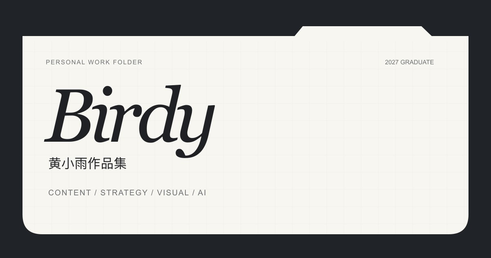

# Birdy 黄小雨｜个人作品集

**2027 届 · 内容 / 创意 / 策划 / 影像 / AI**

## [点击进入完整作品集 ↗](https://birdy-hxy-portfolio.pages.dev/)

从理解问题，到提出想法，再到把它真正做出来。

我习惯从品牌、Brief 与内容目标出发，拆解需求、寻找核心问题，并将判断转化为创意方案。同时持续学习新的工具与方法，探索 AI 如何参与内容和真实工作。

## 快速浏览

| 栏目 | 内容 | 在线入口 |
| --- | --- | --- |
| WORK | 人物访谈、品牌 TVC、年度大会与商业项目 | [查看工作项目](https://birdy-hxy-portfolio.pages.dev/#work) |
| AI | AI 工作流、产品实践与 AIGC 短片 | [查看 AI 实践](https://birdy-hxy-portfolio.pages.dev/#ai) |
| FILMS | 导演、编剧及后期参与的影像作品 | [查看影像作品](https://birdy-hxy-portfolio.pages.dev/#films) |
| ABOUT | 个人介绍、联系方式与简历入口 | [查看个人介绍](https://birdy-hxy-portfolio.pages.dev/#about) |

## 精选工作项目

| 项目 | 本人角色 | 查看详情 |
| --- | --- | --- |
| 《易立竞｜言外之易》 | 分集导演 / 内容策划，参与 8 期全程人物访谈制作 | [人物研究、采访与后期](https://birdy-hxy-portfolio.pages.dev/work/yanwaizhiyi/) |
| 腾讯音乐集团 TME DAY 年度大会 | 内容策划 / 篇章视频导演；项目推进中 | [大会创意与篇章视频](https://birdy-hxy-portfolio.pages.dev/work/tme-day/) |
| 抖音美妆官方号 | 季度合作项目负责人（乙方） | [内容与视觉统筹](https://birdy-hxy-portfolio.pages.dev/work/douyin-beauty/) |
| 珀莱雅 × ONER TVC | 副导演 | [创意、筹备与执行](https://birdy-hxy-portfolio.pages.dev/work/proya/) |
| 可口可乐 × 爱奇艺《不眠日》中插广告 | 副导演 | [15 秒中插广告](https://birdy-hxy-portfolio.pages.dev/work/coca-cola/) |
| 知乎新知青年大会传播短片《人，AI有话要问》 | 副导演 | [创意概念与屏幕视觉](https://birdy-hxy-portfolio.pages.dev/work/human-ai/) |
| 院线电影《火焰驹》 | 现场剪辑 / 前期导演组策划 | [LED 虚拟拍摄与实时反馈](https://birdy-hxy-portfolio.pages.dev/work/huoyanju/) |

各项目的本人职责、制作过程、工作材料与成片见对应详情页。

## AI 实践

- [AI 赋能提效](https://birdy-hxy-portfolio.pages.dev/ai/workflow/)：Skill 搭建、资料搜寻、万字文档与视觉参考生成。
- [AI 产品创造](https://birdy-hxy-portfolio.pages.dev/ai/build/)：个人秋招工作台、Vibe Coding 个人作品集网站。
- [AIGC 创作](https://birdy-hxy-portfolio.pages.dev/ai/creation/)：1 分钟 AIGC 短片《花木兰》及创作流程。

## 影像作品

[《行到水穷》](https://birdy-hxy-portfolio.pages.dev/films/water/) · [《影子没有的地方》](https://birdy-hxy-portfolio.pages.dev/films/shadow/) · [《全知视角》](https://birdy-hxy-portfolio.pages.dev/films/omniscient/) · [《阳光漫慢》](https://birdy-hxy-portfolio.pages.dev/films/sunshine/) · [《环形废墟》](https://birdy-hxy-portfolio.pages.dev/films/ruins/)

---

这个仓库提供作品集概览与在线入口。完整项目、成片和简历请在[作品集网站](https://birdy-hxy-portfolio.pages.dev/)查看。
